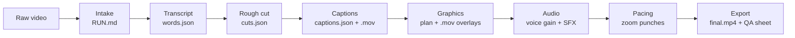

# Vibe Editor Workflow

> Turn one raw video into a verified, postable vertical reel.
>
> **Input:** a video with audio  
> **Output:** `projects/<job>/outputs/<job>.final.mp4` plus a review sheet  
> **Default lane:** ffmpeg  
> **Default tier:** basic  
> **Canvas:** 1080 x 1920 at the source frame rate, normally 30 fps

---

## The idea in one minute

Vibe Editor is a file-based editing pipeline. It does not keep the edit inside a chat or hide decisions in a timeline. Each stage reads an artifact from disk, writes the next artifact, and runs a gate that can fail.



The system separates two responsibilities:

- **Presets say what the edit looks like.** Numbers, caption geometry, graphic templates, motion, and audio targets live in `presets/`.
- **Lanes say how the edit is rendered.** The ffmpeg lane assembles and verifies the result. The Premiere lane replays the same edit into a trimmable Premiere sequence when available.

The creative document is `graphics-plan.json`. It chooses when to show a graphic, which preset to use, and what real evidence fills it. The preset owns the motion and styling.

---

## 1. Set up the machine

The supported workflow is tested on macOS. Windows has a setup script as well. Premiere Pro is optional when using the ffmpeg lane.

### Required for the default ffmpeg workflow

- Node.js 22 or newer
- Python 3.13 for the workflow scripts
- Python 3.11 for WhisperX
- `ffmpeg`
- `uv`
- `jq`
- Python packages: `opencv-python`, `numpy`, and `jinja2`
- HyperFrames and its headless Chrome dependency

Run the macOS setup script from the repository root:

```bash
./scripts/setup-macos.sh
```

The setup script prepares HyperFrames, the optional Premiere MCP bridge, Claude Video's `/watch` tooling, the brand scaffold, and the WhisperX environment. It also runs diagnostics.

If you prefer to install WhisperX yourself:

```bash
uv venv --python 3.11 .venv-whisperx
uv pip install --python .venv-whisperx/bin/python whisperx
```

Configure the channel before making a reel:

```bash
node scripts/brand.mjs init
node scripts/brand.mjs build
```

Edit `brand/BRAND.md` for voice, banned visuals, required proof, and CTA rules. Edit `brand/brand.json` for machine-readable colors, fonts, canvas settings, and export defaults. Rebuild `brand/tokens.css` after changing the JSON.

### Optional Premiere setup

Premiere is a refinement lane, not a prerequisite for delivery. To use it:

1. Open Premiere Pro and a project.
2. Open **Window > Extensions > MCP Bridge (CEP)**.
3. Set the bridge temp directory to `/tmp/premiere-mcp-bridge`.
4. Click **Save Configuration**, **Start Bridge**, and **Test Connection**.
5. Run the job with `--lane premiere`.

The bridge is local. Premiere must be installed on the same machine as the repository and rendered media.

---

## 2. Create a job

Create a job from a source file. Intake copies the source into the job; it never moves or edits the original.

```bash
python workflows/new-job.py ~/Downloads/take.mp4 \
  --slug my-reel \
  --brief "Edit this end to end. Keep my exact words."
```

Useful options:

```text
--lane ffmpeg|premiere       Rendering and editing lane; default is ffmpeg
--tier basic|premium         Visual tier; default is basic
--preset vertical/default    Preset numbers and rules
--music /path/to/track.mp3  Copy an optional music file into the job
--force                      Reuse an existing job folder and recreate RUN.md
```

This creates `projects/my-reel/` with the raw source, working directories, and `RUN.md`. Intake records the source checksum, duration, dimensions, frame rate, aspect format, lane, tier, and brief.

A job is valid only when it has `RUN.md`. Every later command uses that file to find the source, preset, frame rate, and current node statuses.

---

## 3. Run the complete pipeline

For the normal unattended run:

```bash
./run.sh projects/my-reel
```

The command runs nodes in order and stops at the first failed gate. It will:

1. transcribe the source;
2. create and validate the rough cut;
3. plan and render captions;
4. draft or build the graphics plan, render graphics, and run pixel QA;
5. measure voice loudness and place SFX;
6. audit pacing and add zoom punches where needed;
7. export and verify the final file.

When it finishes, inspect:

```bash
open projects/my-reel/review/final-sheet.png
open projects/my-reel/outputs/my-reel.final.mp4
```

The final file is also copied to `~/Downloads/my-reel.final.mp4` when possible.

### Run only part of a job

Use a partial run when you want to review or edit an intermediate artifact:

```bash
./run.sh projects/my-reel --to captions
```

This stops after captions. You can then edit `graphics-plan.json` or add assets before continuing:

```bash
./run.sh projects/my-reel --from graphics
```

Other useful controls:

```bash
./run.sh projects/my-reel --lane premiere
./run.sh projects/my-reel --no-auto-fix
./run.sh projects/my-reel --from captions --to graphics
```

The pipeline refuses to run a node before its predecessors are complete. When an earlier artifact changes, later statuses become stale and should be regenerated from the node that reads the changed file.

---

## 4. The eight stages

### 01. Intake: establish the job

**Script:** `workflows/new-job.py`  
**Writes:** `RUN.md`, `raw/<source>`

Intake copies the source, checks that it has audio, probes its duration and dimensions, calculates a checksum, detects vertical or horizontal format, and records the brief.

The vertical preset is the tuned path. Horizontal video can run, but its placement rules are not tuned for that format.

### 02. Transcript: create the timing foundation

**Script:** `workflows/transcribe.py`  
**Writes:** `transcript/words.json`, `transcript/segments.json`, `transcript/corrections-applied.json`

WhisperX is the primary engine: large-v3, CPU-friendly int8 mode, and Silero VAD. It produces word-level start and end times. Unaligned tokens are interpolated instead of silently dropped. Product-name corrections come only from `presets/vertical/default/transcript-corrections.json`; grammar and slang are preserved.

The transcript gate checks monotonic timing, word duration, suspicious gaps, confidence, and overall speech density.

A HyperFrames transcription fallback is available:

```bash
python workflows/transcribe.py projects/my-reel --engine hyperframes
```

### 03. Rough cut: remove dead air as data

**Script:** `workflows/rough-cut.py`  
**Writes:** `cuts.json`, optionally `cuts.overrides.json`, `preview/spine.mp4`

The rough cut is an edit decision list, not a flattened video. It removes configured silence gaps, filler words, and immediate false starts while preserving intentional voice tics such as “like” and “you know.” Very short kept clips are merged back into neighboring material.

Review removals before accepting them:

```bash
python workflows/rough-cut.py projects/my-reel --review
```

To keep a removal, add its ID to `projects/my-reel/cuts.overrides.json`:

```json
{
  "keep_ids": ["r003"]
}
```

Re-run the rough cut and validate the EDL:

```bash
python workflows/rough-cut.py projects/my-reel
python workflows/validate-edl.py projects/my-reel
```

The ffmpeg lane then assembles `preview/spine.mp4` and checks that no silence longer than the configured threshold survived.

### 04. Captions: turn word times into readable lines

**Scripts:** `workflows/plan-captions.py`, `workflows/build-captions.py`  
**Writes:** `captions.json`, `compositions/captions.html`, `renders/captions.mov`, `preview/captions.mp4`

Caption planning maps surviving source words into timeline time through `cuts.json`. It groups them into short single-line captions, keeps the speaker's wording, and chooses occasional payload-word emphasis. The default design uses a bold sans face with an italic serif accent.

Captions are hard cuts: on or off, with no slide or fade. They sit in the default vertical band around y=920–1130 and are limited by width and word count.

You may edit `captions.json` before building to adjust grouping or emphasis. The builder enforces timing against the first word of each group.

### 05. Graphics: choose proof, then render it

**Scripts:** `workflows/draft-plan.py`, `validate-plan.py`, `face-frame.py`, `build-graphics.py`, `graphics-qa.py`, `fix-plan.py`  
**Writes:** `graphics-plan.json`, `review/faces.json`, `compositions/*.html`, `renders/*.mov`, `review/qa-round-*.json`, `review/qa-round-*.png`

This is the main creative stage. A graphic should show what the words cannot, using real evidence from the job. The plan contains the cue time, duration, preset, placement, parameters, provenance, reveal timings, and optional caption mute window.

The basic tier has ten presets:

| Preset       | Best for                                            |
| ------------ | --------------------------------------------------- |
| `phrase`     | A claim or payoff in a designed text lockup         |
| `list-card`  | A spoken list with rows revealed in order           |
| `flow`       | A process, sequence, or before-to-after explanation |
| `metric`     | A verified number with provenance                   |
| `app-mock`   | A real app, page, or interface capture              |
| `receipt`    | A real proof image, document, or still              |
| `thumb-wall` | Several real images, a result wall, or comparison   |
| `chat`       | A literal CTA or DM/comment exchange                |
| `wash`       | A bad-to-good or negative-to-positive turn          |
| `rec-frame`  | Calling attention to the footage itself             |

The drafter can create a starting plan:

```bash
python workflows/draft-plan.py projects/my-reel
```

For higher-quality work, review and edit the plan yourself or have an agent author it from the transcript, captions, brand rules, and real assets. Do not invent screenshots, metrics, handles, testimonials, or comparisons.

The plan validator rejects unknown presets, missing assets, placeholders, unsupported placements, graphics outside the timeline, unproven metrics, overlapping placements, and repeated preset runs. It also warns about low visual presence or long static stretches.

Placement is computed from the detected face when set to `auto`: beside the side opposite the face, inline below the caption band, or a cutaway when captions are muted.

Graphics are rendered as transparent HyperFrames `.mov` overlays. QA composites them over the actual spine and checks alpha, caption-band collisions, face overlap, stale renders, blank frames, unwanted darkening, and invalid opaque surfaces. The automatic repair loop can run for at most three rounds. If defects remain, the node is marked `blocked`.

### 06. Audio: measure first, then add sound

**Scripts:** `workflows/voice-gain.py`, `workflows/sfx-plan.py`  
**Writes:** `audio/voice-gain.json`, `sfx-plan.json`, `preview/audio.mp4`

Voice level is measured from the spine rather than guessed. The default target is -16 LUFS integrated with a -1.5 dBFS peak ceiling and a limiter applied by the lane.

SFX are derived from placed graphics: normally one tactile sound per visual event, not one sound per word. The plan maps preset verbs such as `pop`, `whoosh`, `click`, `tick`, and `shutter` to files in `presets/vertical/default/sfx/`, copying them into `assets/sfx/` as needed.

Music is opt-in. It is used only when a music file is supplied and the brief asks for music or a track. The opening claim gets a quieter bed, and the bed is ducked under voice.

### 07. Pacing: audit every meaningful change

**Script:** `workflows/pacing-audit.py`  
**Writes:** updated `cuts.json` with zoom punches, `preview/spine.mp4`

Pacing is measured from cuts, caption changes, graphic entrances and reveals, SFX, and existing zooms. Any static stretch longer than the configured two seconds gets reported. With `--fix`, the cheapest available interrupt is a small zoom punch, normally 3% over 1.2 seconds.

```bash
python workflows/pacing-audit.py projects/my-reel --fix
python workflows/pacing-audit.py projects/my-reel
```

Zooms live in the EDL so both lanes can reproduce them.

### 08. Export: prove the file exists

**Scripts:** `finalize.sh`, `workflows/verify-final.py`  
**Writes:** `outputs/<job>.final.mp4`, `review/final-sheet.png`

The ffmpeg lane creates the final H.264 MP4 with the configured bitrate, pixel format, frame rate, and AAC audio. The Premiere lane attempts a sequence export first and falls back to ffmpeg if Premiere fails.

Verification checks the output file and its freshness, duration against the EDL, canvas size, loudness, long silences, and caption geometry. It also creates a 12-frame contact sheet for human review.

A successful gate means the file is technically coherent. Human review still decides taste, clarity, and whether the edit feels right.

---

## 5. The job folder: where to look

```text
projects/<job>/
├── RUN.md                         state, brief, node statuses, and gate results
├── raw/                           copied source video
├── transcript/                    audio.wav, words, segments, corrections
├── cuts.json                      rough-cut EDL and pacing zooms
├── captions.json                  caption groups and mute windows
├── graphics-plan.json             the creative graphics plan
├── sfx-plan.json                  placed SFX and optional music
├── assets/                        screenshots, stills, and copied SFX
├── compositions/                  generated HyperFrames HTML
├── renders/                       caption and graphic alpha movies
├── preview/                       cumulative stage renders
├── review/                        face data, QA reports, and contact sheets
└── outputs/                       verified final MP4
```

`RUN.md` is the first file to read when resuming a job. It records status and explains what happened at each node. Do not trust a command's success message alone; confirm the artifact and the gate on disk.

---

## 6. What the two lanes mean

### ffmpeg: default and verification lane

The ffmpeg lane is deterministic and works without Premiere. `lanes/ffmpeg/assemble.py` replays the EDL, overlays captions and graphic alpha movies, mixes voice, SFX, and optional music, and encodes the result. It is both the fallback and the delivery path.

### Premiere: refinement lane

The Premiere lane replays each kept range as a separate, trimmable clip in a `<job>__CUT` sequence. It reads the placed clips back and writes `premiere/replay-verify.json`; the read-back is the gate, not the MCP success response.

The lane matrix in `LANES.md` is intentionally honest. Transcript and rough-cut replay are scripted, while some caption, graphics, audio, pacing, and export operations remain manual or unvalidated. Premiere export is still proven on disk and falls back to ffmpeg when necessary.

---

## 7. Make the system yours

### Brand

- Edit `brand/brand.json` for colors, fonts, canvas, and export values.
- Edit `brand/BRAND.md` for voice, proof standards, banned visuals, and CTA behavior.
- Rebuild with `node scripts/brand.mjs build`.

### Preset numbers

`presets/vertical/default/numbers.json` is the single home for cut thresholds, caption geometry, graphic placement, pacing, audio targets, and export settings. Change numbers there instead of putting constants in a skill or one-off script.

### Transcript corrections

Add product names and spellings to `presets/vertical/default/transcript-corrections.json`. Corrections are applied only during transcription and are logged in the job.

### SFX

Replace or extend the files in `presets/vertical/default/sfx/`, then keep the same names in `sfx.json` so graphic verbs resolve correctly.

### New graphic preset

A preset folder under `presets/graphics/` should contain:

- `template.html` for the HyperFrames composition;
- `params.schema.json` for validation and placement rules;
- `example.json` with real-looking valid parameters;
- `README.md` explaining when to use it;
- `golden.png` as the visual regression reference.

Render its golden before relying on it:

```bash
python workflows/build-graphics.py \
  --preset presets/graphics/<name> \
  --params presets/graphics/<name>/example.json \
  --write-golden
```

---

## 8. Regression and troubleshooting

Run the regression suite after changing `workflows/` or `presets/`:

```bash
tests/regress.sh
```

It checks every preset against its golden frame and checks that the fixture's EDL and caption grouping remain deterministic.

Common problems:

| Symptom                                                | First place to look                                                 |
| ------------------------------------------------------ | ------------------------------------------------------------------- |
| `no RUN.md`                                            | Create the job with `workflows/new-job.py`                          |
| WhisperX is missing                                    | `.venv-whisperx/` and the setup command above                       |
| `jq` command not found                                 | Install `jq`; `run.sh` uses it for the silence gate                 |
| Captions drift or fail timing                          | `transcript/words.json`, `cuts.json`, then `captions.json`          |
| Graphic is rejected for a placeholder or missing image | `graphics-plan.json` and the preset schema                          |
| Graphic covers a face or captions                      | `review/qa-round-*.json` and `review/faces.json`                    |
| Graphics remain blocked after three rounds             | Fix the plan or supply better real assets; do not lower the QA gate |
| Premiere is unavailable                                | Start the MCP Bridge, or use the ffmpeg lane                        |
| Export claims success but no file exists               | Check `outputs/`; `finalize.sh` is designed to fail and fall back   |
| Horizontal output looks awkward                        | The vertical preset is tuned for 9:16; review placement manually    |

The project keeps historical failure notes in `docs/lab-notes-archive.md`. The implementation map is `CLAUDE.md`; the lane capability matrix is `LANES.md`; the human setup overview is `README.md`.

---

## Definition of done

A Vibe Editor job is done when:

- `RUN.md` shows the pipeline completed and its gates passed;
- `outputs/<job>.final.mp4` exists and is newer than the run;
- the final duration matches the kept EDL;
- no dead air above the configured threshold remains;
- voice loudness is within tolerance;
- captions fit their band and width rules;
- graphics have passed composited pixel QA;
- the final contact sheet and MP4 have been reviewed at full size;
- any remaining notes are about taste, not objective defects.

The guiding rule is simple: **the files are the edit, the gates are the proof, and the final review is for taste.**
